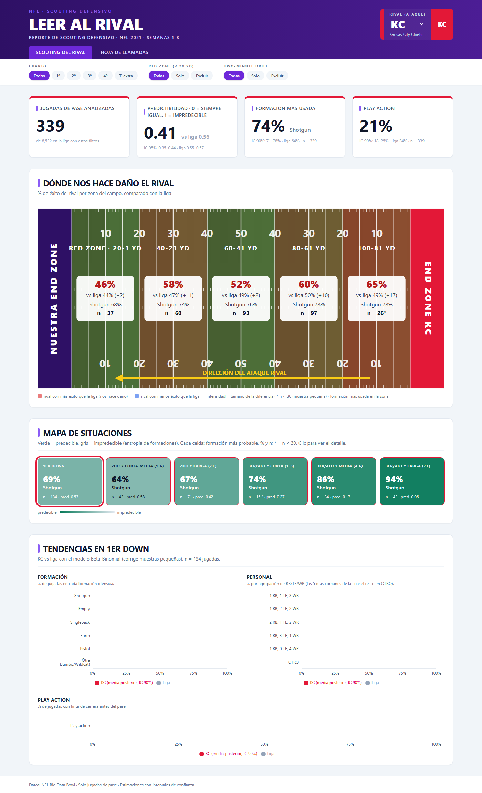

# THE IQ Interceptors · Leer al rival

Un coordinador defensivo que se prepara para el domingo necesita responder dos preguntas: qué va a hacer el ataque rival en cada situación y qué defensa conviene llamar contra él. 

Leer al rival le da esa respuesta en una hoja que puede llevar al campo. La hoja dice, situación por situación, qué formación y qué tan seguido el play action esperar, qué cobertura le ha funcionado peor al rival y cuál conviene evitar. 

La app también muestra en un campo de juego dónde nos hace más daño cada ataque. El hallazgo principal es que presionar con cinco o más jugadores no es gratis: gana algunos sacks e intercepciones, pero permite casi la misma cantidad de jugadas explosivas, y algunos rivales, como Kansas City, son claramente más predecibles que el resto de la liga en sus formaciones.

Detrás de cada recomendación hay estadística pensada para muestras pequeñas: un modelo Beta-Binomial que corrige las tendencias de cada rival con lo que hace la liga, un índice de predictibilidad basado en la entropía de sus formaciones e intervalos de confianza por bootstrap en cada cifra; cuando los datos del rival no alcanzan, la app lo dice y recurre a la liga. Para usarla, elige al rival, filtra por cuarto, red zone o two-minute, revisa "Scouting del rival" y abre "Hoja de llamadas" para imprimir el plan.

