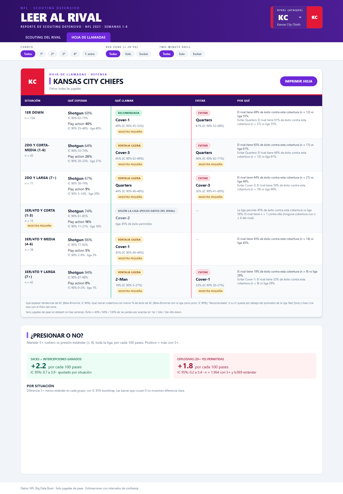

# Leer al rival

La pregunta del coach defensivo es qué va a hacer el ataque rival en cada situación y qué defensa conviene llamar contra él. El hallazgo principal: en toda la liga, mandar 5 o más rushers genera +2.2 sacks o intercepciones por cada 100 pases (IC 95%: 0.7 a 3.9) pero permite +1.8 jugadas explosivas de 20+ yardas (IC 95%: 0.2 a 3.4), ya ajustado por situación (1,964 pases con 5+ contra 6,069 con presión estándar); además, Kansas City es más predecible que la liga en sus formaciones, con un índice de 0.41 (IC 95%: 0.35 a 0.44, n = 339) contra 0.56 de la liga. Las tendencias de cada rival se corrigen con un modelo Beta-Binomial que usa a la liga como prior, la predictibilidad es la entropía de Shannon normalizada de sus formaciones y los intervalos de eficacia salen de un bootstrap de 1,000 remuestreos con semilla fija (detalle en `docs/metodologia.md`; solo jugadas de pase). Para usar la app, elige al rival arriba, filtra por cuarto, red zone o two-minute, revisa "Scouting del rival" para ver dónde te hace daño y abre "Hoja de llamadas" para imprimir qué esperar, qué llamar y qué evitar en cada situación.

Este trabajo se hizo durante el evento y solo por los participantes
